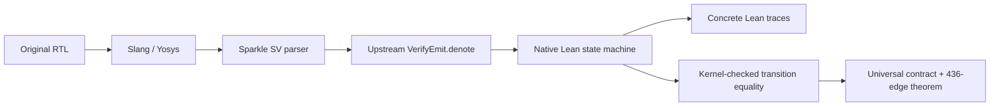

# Task 2: RTL → Sparkle → Lean

A separate, reproducible demo of the frozen Task 2 accelerator using
[Verilean/Sparkle](https://github.com/Verilean/sparkle). The original demo is
preserved. Everything added here stays inside `SparkleDemo/`.

**The result:** a universal equivalence theorem for any two length-16 int32
vectors, plus a proof that the first result appears after exactly **436 rising
edges**. Arithmetic wraps modulo 2³². The contract covers one transaction with
four reset edges and the original fixed handshake; permitted initial registers
and the initial start bit remain arbitrary.

## Run

From the experiment directory:

```sh
bash SparkleDemo/setup.sh        # Once; already installed in this workspace.
bash SparkleDemo/run.sh          # Fresh import, controls, universal proof, mutation.
python3 -m unittest discover -s SparkleDemo/tests -v
```

For a shorter iteration, use `run.sh controls` or `run.sh proof`. The proof stage
requires a successful controls run and checks its source/model identities.
`run.sh --help` lists the commands. Progress goes to the terminal; full command
logs and machine-readable verdicts go to `build/`.

Setup downloads a SHA-256-checked Lean archive (~533 MiB) and pinned dependencies.
The original Nix tools, frozen RTL and prepared Task 2 reference proof library
are required; their paths and hashes are in [pins.json](pins.json).
Sparkle uses Lean **4.32.1** and the retained proof library uses **4.35.0**.
The same generated native Lean source checks in both. See [DESIGN.md](DESIGN.md)
for environment overrides and translation boundaries.

## Follow the model



Operator meanings come from **Sparkle's upstream reflector**. The demo supplies
named records, wire declarations and record-coordinate adapters. There is no
private operator interpreter or second IR-to-Lean semantics implementation.
The same native model runs the Lean controls and appears in the universal proof.

Read these files in order:

| File | Purpose |
| --- | --- |
| [ExportTask2.lean](ExportTask2.lean) | The two-line native import entry point. |
| [NativeExport.lean](NativeExport.lean) | Delegate expressions to Sparkle; emit named ports, registers and shared wires. |
| [NativeTraces.lean](NativeTraces.lean) | Execute the native model with the transaction protocol. |
| [Proof/Main.lean](Proof/Main.lean) | Fresh artifact check and the two public theorems. |
| [Proof/README.md](Proof/README.md) | How all 453 state fields and five outputs establish the theorem. |

After a run, inspect `build/native/Task2RTL.lean` for the actual imported circuit.
Its register names match the RTL; each wire and register update has a source-name
comment. [DESIGN.md](DESIGN.md) explains the frontend, memory lift and trust scope.

## Evidence

Seven controls compare every handshake cycle and accepted payload across original
RTL Verilator, native Lean and Sparkle C. They include negative values, overflow,
cancellation and the original **816** example. These controls supplement the
universal proof. The runner also changes the native result by XOR 1 and requires
the fresh artifact theorem to fail.

| Output | Contents |
| --- | --- |
| `build/result.json` | Fresh import and seven three-way trace comparisons. |
| `build/universal-result.json` | Universal proof, 458 field checks, axiom audit and rejected mutation. |
| `Proof/build/` | Generated obligations and complete Lean proof logs. |
| [reports/](reports/) | Retained evidence, including the initial demo and the native-model improvement. |

The final theorems use only `propext`, `Classical.choice` and `Quot.sound`.
The new full transition proof permits reuse of the original temporal theorem;
the retained reference model is still a dependency. This demo does not invoke
xiangshan2Lean. RTL elaboration and Sparkle's translation remain declared trust
boundaries. Backpressure, repeated transactions and the optimized candidate are
outside this contract.
